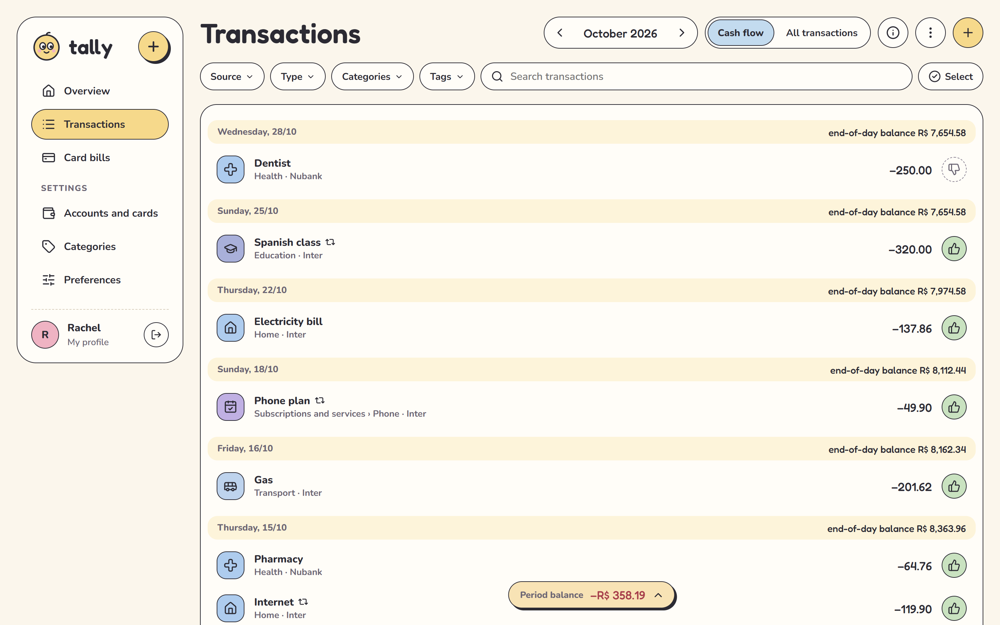
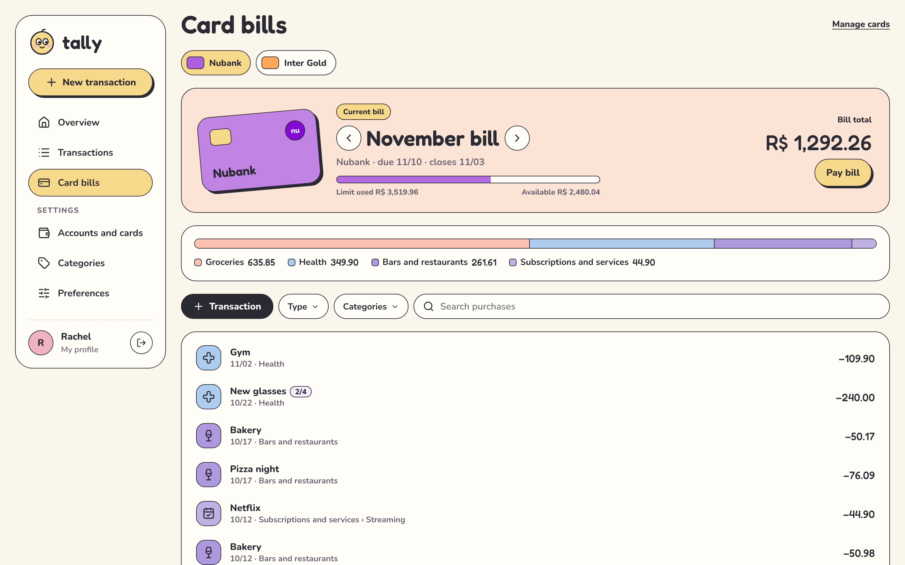

# Tally

A personal finance app for tracking accounts, credit card bills and upcoming payments, built around how money actually moves in Brazil.


**[Live demo](https://tallycoin.vercel.app/demo)** (sample data kept in your browser, no sign-up)

## Overview

Money in Brazil runs on the credit card: purchases split into instalments, bills that close on one day and fall due on another, and fixed monthly expenses. The finance app I used handled this but charged a monthly fee and didn't quite fit how I work, so I built my own. The biggest change: money I put into savings disappears from every total, so the balance I see is the money I can actually spend. It runs on desktop and installs on a phone's home screen.

## Features

- Accounts and credit cards, each card with its limit, closing day and due day; purchases land on the right bill automatically
- Fixed (recurring) entries and instalment purchases, shown as "2/4" on each bill
- Two views of the same month: **Cash flow** shows each unpaid card bill as one expense on its due date, **All transactions** shows every purchase instead
- Pay a card bill in full or in part, from any account
- Savings accounts kept out of the balance, income and expense totals, with a toggle to show the amount saved
- Categories with subcategories, tags, file attachments, search and filters, and export to CSV
- Accounts in other currencies (US dollar, euro, pound, Canadian dollar); a transfer between currencies keeps both amounts and shows the rate you actually paid
- Light and dark themes, English and Portuguese, keyboard shortcuts (E, I, T) for a new expense, income or transfer





## How it works

**No custom back end.** The app talks to Supabase directly from the browser: Postgres for data, Supabase Auth for accounts and Storage for attachments. Privacy is enforced in the database, not in app code. Every table has row-level security policies that only let a signed-in user read and write rows where `user_id = auth.uid()`, and attachment files sit under a folder named after the user with the same rule. That's why the publishable key can live in the source code. "Delete my account" is a single `security definer` function that removes the user, and every table cascades from it.

**Money is stored in integer cents.** Amounts are `bigint` columns, never floats, so R$ 0.10 + R$ 0.20 is always R$ 0.30. Instalments are split in cents with the rounding remainder on the first one, so the parts always add up to the purchase.

**Balances are derived, not stored.** There's no balance column to drift out of sync. An account's balance is its opening amount plus every transaction that touches it, computed in pure functions (`src/lib/balances.ts`) that are unit-tested. A card purchase stores only which bill it belongs to (`invoice_month`), picked from the card's closing day when it's saved; bill totals, what's left to pay and the available limit are all computed from those rows (`src/lib/cards.ts`). The Cash flow view swaps card purchases for one generated "bill" row per unpaid invoice, so the month reads like a bank statement.

**The database rejects impossible transactions.** One `transactions` table holds expenses, income, transfers and bill payments, and check constraints spell out what each kind must have: an expense comes from an account or a card but never both, a transfer needs a destination account, a bill payment needs an account and a card, and only card entries carry a bill month. A bug in the interface can't write a half-formed row.

**Currencies keep what you typed, not a conversion.** Each account has one currency, and a transfer between currencies stores both sides: the amount that left and the amount that landed (`to_amount_cents`). The rate is derived from those two numbers, so it's the rate your bank actually gave you, fees included. Totals add up only accounts in your main currency; money sent abroad shows as its own slice, like savings. An approximate converted total is optional and off by default: it fetches the European Central Bank's daily rates from Frankfurter, which needs no API key, caches them for hours, and nothing stored ever depends on them.

**Recurring entries are real rows.** A fixed entry creates its occurrences up to a year ahead, all linked to a series. Each one can then be edited, paid or deleted on its own, or together with the ones after it, which is what makes "change this and the following" possible.

**State lives in TanStack Query.** Each table is one cached query, and every save invalidates it, so all screens agree after a change. The demo swaps the Supabase table layer for one backed by localStorage with generated sample data, and every screen runs unchanged on top of it.

**It's a PWA, not a native app.** A service worker keeps the app shell so it opens from the home screen without signal. It never caches Supabase responses, so the numbers on screen always come from the database. Below 760px wide the layout becomes a phone app with bottom tabs and bottom sheets.

## Tech

- **Frontend:** React 19, TypeScript, Vite, React Router, TanStack Query, lucide-react icons; plain CSS
- **Back end:** Supabase (Postgres with row-level security, Auth, Storage), schema in SQL migrations
- **Hosting:** Vercel, with a preview deployment for every pull request
- **Tests:** Vitest for balances, card bill dates, recurring series and period summaries

## Running it locally

### Prerequisites

- Node.js 20.19 or newer

```bash
git clone https://github.com/rachelmgaldino/tally.git
cd tally
npm install
npm run demo    # sample data in the browser, no account or database needed
npm test
```

### With your own Supabase project

1. Create a Supabase project and run each file in `supabase/migrations/` in order in the SQL Editor.
2. Create a `.env.local` file in the project root:

```
VITE_SUPABASE_URL=https://your-project.supabase.co
VITE_SUPABASE_KEY=your-publishable-key
```

Both come from your project's API settings. The publishable key is meant to be public; row-level security is what protects the data.

3. Run `npm run dev` and create an account at `/criar-conta`.

## What I'd improve

- [ ] Fixed entries are created a year ahead and aren't extended after that yet. A recurring bill set up today stops appearing after next year
- [ ] No bank statement import. Every transaction is typed in by hand
- [ ] No password reset on the sign-in screen
- [ ] The app loads every transaction into the browser and computes totals there. That's instant for one person's history, but it would need database-side aggregates for years of heavy use

AI disclosure: Tally was built with Claude Code. I set the product direction and design, and reviewed, tested and merged every change; Claude drafted much of the implementation.

## Contact

**Rachel Galdino**
- Email: [rachel.galdino@proton.me](mailto:rachel.galdino@proton.me)
- LinkedIn: [linkedin.com/in/rachel-galdino](https://www.linkedin.com/in/rachel-galdino/)
- GitHub: [github.com/rachelmgaldino](https://github.com/rachelmgaldino)
